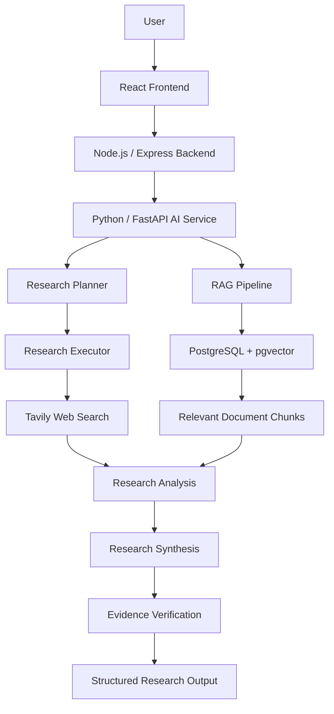

# 🔭 Scout — AI-Powered Research Assistant

**Research smarter. Connect knowledge. Discover insights.**

Scout is an AI-powered research assistant designed to help users explore complex topics through web research, Retrieval-Augmented Generation (RAG), document retrieval, and multi-stage AI analysis. It combines external web sources with relevant document context to generate structured, evidence-oriented research outputs.

The project is built around a modular architecture that separates the application backend, Python-based AI services, retrieval pipeline, and advanced research workflow.

---

## ✨ Features

- **🌐 AI-Powered Web Research** — Gather relevant information from web sources using Tavily.
- **🧠 Retrieval-Augmented Generation (RAG)** — Ground AI-generated responses in retrieved information.
- **📄 PDF Intelligence** — Ingest PDF documents, split their contents into chunks, generate embeddings, and retrieve relevant passages.
- **🔬 Deep Research Pipeline** — Organize research into planning, searching, source analysis, synthesis, and verification stages.
- **🔎 Semantic Search** — Retrieve relevant document chunks using vector embeddings and PostgreSQL with pgvector.
- **📚 Source-Aware Research** — Maintain source references and research artifacts to support traceability.
- **⚙️ Modular Architecture** — Separate Node.js application services from Python-based AI and research processing.
- **🚀 Extensible Design** — Designed to support future improvements such as conversational document querying, agentic research loops, and richer evidence verification.

---

## 🏗️ Architecture

Scout follows a modular architecture in which the Node.js backend communicates with a dedicated Python AI service.



### Research Workflow

1. **Query Processing** — Receive and validate the user's research question.
2. **Research Planning** — Create a structured plan for investigating the topic.
3. **Information Retrieval** — Gather relevant web information and, where integrated, retrieve relevant PDF passages.
4. **Source Analysis** — Analyze retrieved evidence and preserve source metadata.
5. **Research Synthesis** — Combine analyzed findings into a structured report.
6. **Verification** — Run the report through a separate evidence-verification stage.
7. **Output Generation** — Return the research report, verification results, and relevant metadata.

The standard research and advanced research workflows are designed as separate paths, allowing straightforward questions and more complex investigations to be handled differently.

---

## 🛠️ Tech Stack

| Category | Technologies |
|---|---|
| Frontend | React, Tailwind CSS |
| Application Backend | Node.js, Express.js, TypeScript |
| AI Service | Python, FastAPI |
| AI / LLM | Groq |
| Web Search | Tavily |
| Retrieval Architecture | Retrieval-Augmented Generation (RAG) |
| Vector Storage | PostgreSQL, pgvector |
| Embeddings | Sentence Transformers, `all-MiniLM-L6-v2` |
| PDF Processing | PyMuPDF |
| API Communication | HTTP / REST |
| Data Format | JSON |

*The table reflects the technologies used or discussed in the project architecture; exact integration and completion status may vary by component.*

---

## 📂 Project Structure

The repository is organized around separate application and AI-service components.

```text
Scout/
├── client/                     # Frontend application
├── server/                     # Node.js / Express backend
└── ai-service-python/
    └── app/
        ├── api/
        │   └── research.py     # Research API endpoints
        ├── models/
        │   └── schemas.py      # Request and response schemas
        └── rag/
            ├── pipeline.py
            ├── advanced_research.py
            ├── research_planner.py
            ├── research_executor.py
            ├── research_analyzer.py
            ├── research_synthesizer.py
            └── research_verifier.py
```

*Note: This is a representative structure based on the components discussed. Adjust directory names to match the actual repository.*

---

## 🔬 Deep Research

Scout's advanced research workflow is designed to move beyond a single LLM response.

It separates research into dedicated stages:

- **Research Planner:** Structures the investigation into a research plan.
- **Research Executor:** Collects information from external web sources.
- **Research Analyzer:** Evaluates individual sources and extracts useful evidence.
- **Research Synthesizer:** Organizes analyzed findings into a coherent report.
- **Research Verifier:** Performs a separate verification pass over the generated report.

Research runs can also produce intermediate JSON artifacts, making it easier to inspect the plan, collected data, analysis, synthesis, verification results, and final summary.

This modular approach improves maintainability and makes individual stages easier to test and extend.

---

## 📄 PDF-Based Retrieval

Scout's document retrieval pipeline is designed to make uploaded PDF content useful during research.

The document-processing workflow includes:

1. Extract text from PDF files using PyMuPDF.
2. Divide extracted text into smaller chunks.
3. Generate vector embeddings using Sentence Transformers.
4. Store document chunks and embeddings in PostgreSQL with pgvector.
5. Retrieve relevant chunks using a research query.
6. Supply retrieved passages to the RAG pipeline as contextual evidence.

The advanced research workflow is also being extended to incorporate retrieved PDF passages alongside web sources.

**Implementation note:** End-to-end PDF support in Deep Research requires compatible source handling, evidence preservation, verification, and API/frontend integration. These components should be tested together before describing the complete workflow as production-ready.

---

## ⚙️ Getting Started

### Prerequisites

Install the following before running Scout:

- Node.js and npm
- Python 3.10 or a compatible version for the installed dependencies
- PostgreSQL
- The pgvector PostgreSQL extension
- API credentials for the configured LLM provider and Tavily

### 1. Clone the Repository

```bash
git clone https://github.com/YASHdroid/Scout.git
cd Scout
```

Replace the repository URL if your Scout repository uses a different GitHub path.

### 2. Configure the Python AI Service

```bash
cd ai-service-python
python -m venv .venv
```

Activate the virtual environment.

**Windows PowerShell**

```powershell
.venv\Scripts\Activate.ps1
```

**macOS / Linux**

```bash
source .venv/bin/activate
```

Install dependencies using the project's dependency file, if present:

```bash
pip install -r requirements.txt
```

Create a `.env` file using the environment variables expected by the application.

Example configuration:

```env
GROQ_API_KEY=your_groq_api_key
TAVILY_API_KEY=your_tavily_api_key
DATABASE_URL=your_postgresql_connection_string
```

Use the exact variable names expected by your implementation. Never commit real API keys, passwords, or database credentials.

### 3. Start the Python Service

Run the FastAPI application using the actual module path configured in your project.

For example, if the FastAPI instance is exposed as `app` in `app.main`:

```bash
uvicorn app.main:app --reload
```

### 4. Start the Node.js Backend

Open another terminal and navigate to the backend directory:

```bash
cd server
npm install
npm run dev
```

If your backend uses a different directory or development script, use the corresponding project configuration.

### 5. Start the Frontend

Open another terminal:

```bash
cd client
npm install
npm run dev
```

Open the local URL displayed by Vite in your terminal.

*The commands above are a general setup guide. Confirm the repository's scripts, service entry points, environment variables, and database initialization steps before running them.*

---

## 🔐 Environment Variables

Keep configuration and credentials in environment variables rather than hardcoding them into source files.

| Variable | Purpose |
|---|---|
| `GROQ_API_KEY` | Authentication for the configured Groq LLM service |
| `TAVILY_API_KEY` | Authentication for Tavily web search |
| `DATABASE_URL` | PostgreSQL connection configuration |

Add any additional variables required by the frontend, backend, authentication system, or database setup.

Make sure `.env` files are included in `.gitignore`.

---

## 🧪 Testing and Validation

Before deploying Scout, validate the major components independently and then test the complete research flow.

- [ ] Python AI service starts successfully.
- [ ] Node.js backend connects to the AI service.
- [ ] Standard research returns a valid response.
- [ ] Web search returns usable sources.
- [ ] PDF ingestion extracts text correctly.
- [ ] Embeddings are stored and retrieved successfully.
- [ ] Advanced research produces the expected intermediate artifacts.
- [ ] Source metadata is preserved during analysis and synthesis.
- [ ] Evidence verification handles supported source types correctly.
- [ ] PDF-based Deep Research works end to end, if enabled.
- [ ] API errors and missing configuration are handled appropriately.
- [ ] Secrets are excluded from version control.

---

## 🚧 Roadmap

- [x] Establish a modular Node.js and Python service architecture.
- [x] Build the foundational web research and RAG workflow.
- [x] Develop modular stages for advanced research.
- [x] Implement the foundational PDF ingestion and vector retrieval components.
- [ ] Complete and validate PDF evidence integration across Deep Research.
- [ ] Strengthen source-level and claim-level verification.
- [ ] Add a conversational interface for uploaded documents.
- [ ] Develop agentic research loops for iterative investigation.
- [ ] Improve research progress reporting and error recovery.
- [ ] Expand automated tests and deployment workflows.

*Roadmap items should be updated as features are completed and tested.*

---

## 🎯 Project Goals

Scout aims to make AI-assisted research more useful by combining retrieval, external information gathering, structured analysis, and evidence-aware synthesis.

Rather than relying entirely on an LLM's internal knowledge, the architecture emphasizes retrieving relevant information, separating research stages, and retaining source information throughout the workflow.

The long-term goal is to create a research assistant that can investigate complex questions, work with personal documents, organize findings, and make its research process easier to inspect.

---

## 👨‍💻 Author

**Yash Chopra**

B.Tech Computer Science Student | AI/ML Enthusiast | Full-Stack Developer

- GitHub: [@YASHdroid](https://github.com/YASHdroid)
- LeetCode: [yashchopra0022](https://leetcode.com/u/yashchopra0022/)

---


---

**Scout — Turning information into structured research.** 🔭
